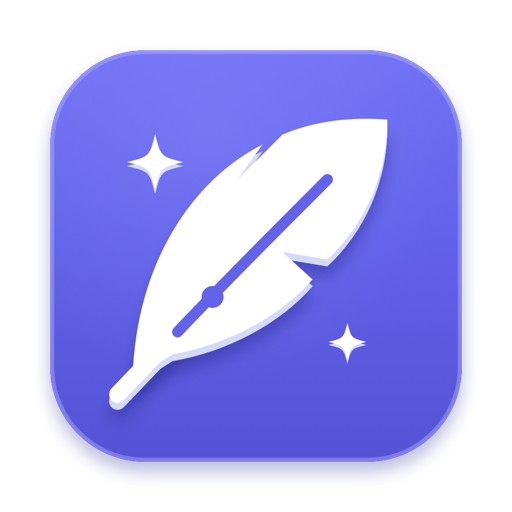
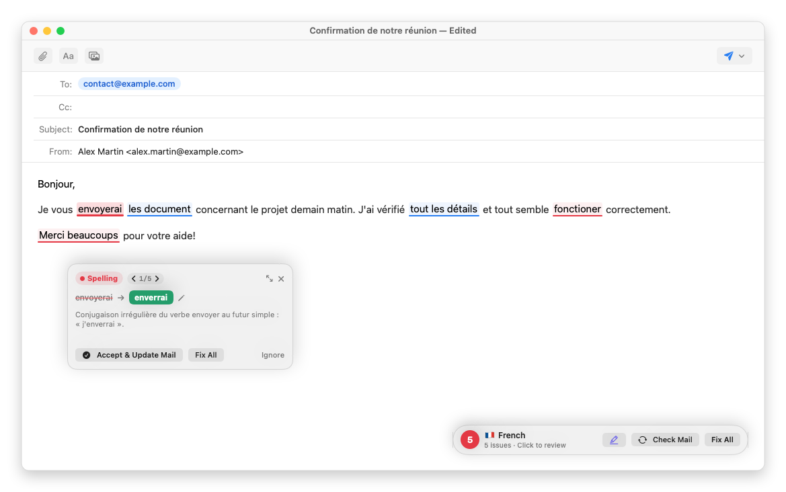
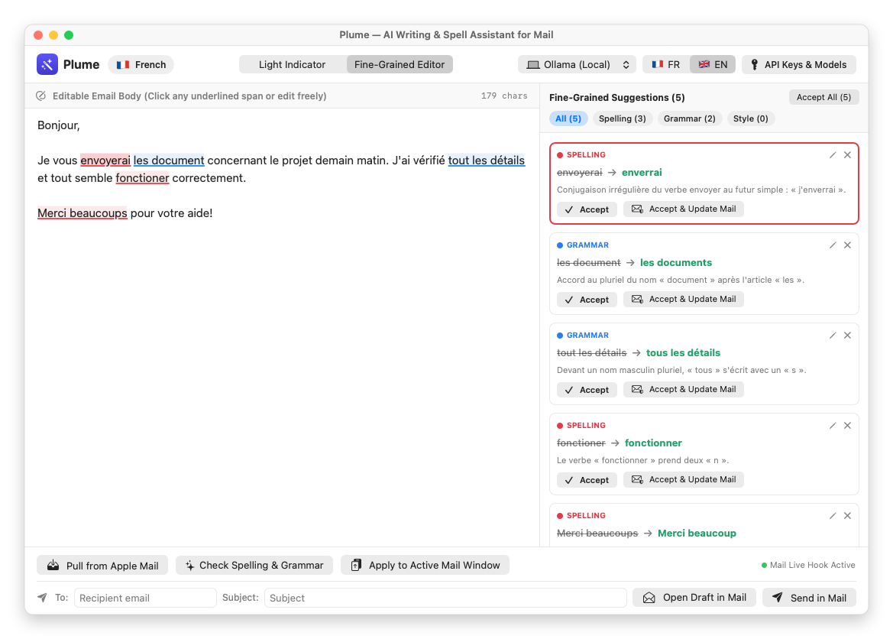
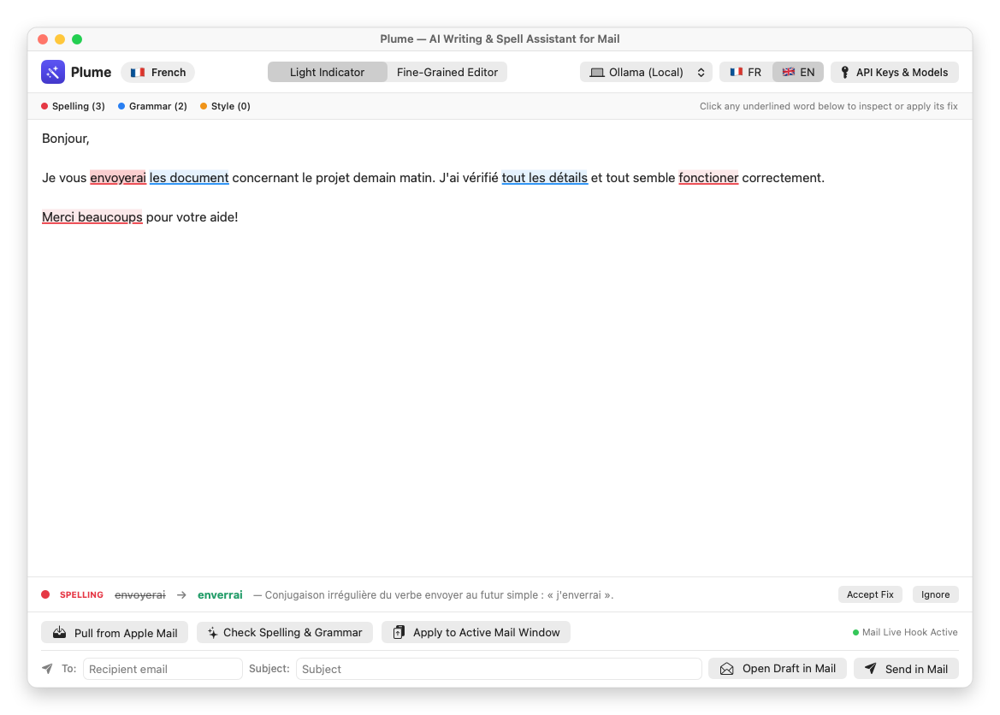

<p align="center">
  
</p>

<h1 align="center">Plume</h1>

<p align="center">
  <strong>Native macOS AI Spell, Grammar & Style Assistant for Apple Mail</strong><br/>
  <em>Assistant IA natif de correction orthographique, grammaticale et stylistique pour Apple Mail sur macOS</em>
</p>

<p align="center">
  <a href="https://github.com/pschaus/plume/releases/latest/download/Plume-macOS.dmg"></a>
  <a href="https://pschaus.github.io/plume/"></a>
  <a href="LICENSE"></a>
</p>

---

## ✨ Overview

**Plume** (`Plume.app`) is a native macOS application built with **Swift 6, SwiftUI, and AppKit** that integrates with **Apple Mail** (`Mail.app`) to check spelling, grammar, and style in your email drafts.

Bring your own cloud API key (**Google Gemini, Anthropic Claude, OpenAI, OpenRouter**) or run **100% locally and privately for free** using **Ollama** (e.g. `gemma4:latest`).

---

## 📸 Screenshots

### Direct In-Mail Integration (*Soulignements, Bulle & Pastille flottante dans Apple Mail*)
Color-coded inline underlines drawn directly beneath words in Apple Mail's compose window, interactive quick-fix popover on hover, and context-aware floating pill with a 1-click inline highlight toggle:



### Fine-Grained Editor Mode (*Mode Éditeur détaillé*)
Full editable email draft on the left and individual suggestion cards on the right (**Accept**, **Accept & Update Mail**, **Ignore**, or customize any suggestion inline):



### Light Indicator Mode (*Mode Indicateur léger*)
Clean color-coded inline underlines (**Red** = Spelling, **Blue** = Grammar, **Amber** = Style) with a bottom quick-fix inspection bar when clicking any highlighted word:



---

## 🚀 Key Features

- **🧠 Multi-Provider AI & 100% Local Ollama**:
  - **Ollama (Local, Free, Offline)**: Auto-discovers installed models from `http://localhost:11434/api/tags` (`gemma4:latest`, `deepseek-r1:32b`, `llama3.2:latest`, `mistral:latest`).
  - **Google Gemini**: `gemini-3.8-flash` (default), `gemini-3.5-flash-lite`, `gemini-3.1-pro-preview` via the Gemini Interactions API (`/v1beta/interactions`).
  - **Anthropic Claude**: `claude-3-5-haiku-latest`, `claude-3-7-sonnet-latest`.
  - **OpenAI**: `gpt-4o-mini`, `gpt-4o`.
  - **OpenRouter**: Unified access to Gemini, Claude, OpenAI, and Llama models.
- **🌍 Automatic Language Recognition**:
  - Automatically detects the language of your draft (`🇫🇷 Français`, `🇬🇧 English`, `🇪🇸 Español`, `🇩🇪 Deutsch`, `🇳🇱 Nederlands`, `🇮🇹 Italiano`, `🇵🇹 Português`) and provides explanations in that same language.
- **✉️ Native Apple Mail Integration**:
  - **Live Inline Underlines & Hover Popover Inside Apple Mail**: Draws color-coded underlines (**Red** = Spelling, **Blue** = Grammar, **Amber** = Style) directly under words in Apple Mail's composer window via `AXBoundsForRange`. Hover over any underlined word (or click the floating pill badge) to apply, customize, or ignore a suggestion right inside Apple Mail.
  - **Context-Aware Floating Pill**: Appears in the bottom-right corner **only** when an Apple Mail compose/reply window is active in the foreground, and hides automatically everywhere else.
  - **Pull from Apple Mail (`⌘⇧R`)**: Reads only your new reply from Apple Mail's active compose window, automatically ignoring quoted email history and signatures below.
  - **Apply to Apple Mail (`⌘⇧A`)**: Updates the text directly inside Apple Mail's active compose window while preserving rich-text formatting (bold, italic, links, lists), inline attachments, signatures, and the quoted reply thread (`<blockquote type="cite">`).
  - **macOS System Service (`⌘⇧;`)**: Select text in any macOS app → Right-click → *Services* → *Check Spelling & Grammar with Plume*.
- **🇫🇷 / 🇬🇧 Bilingual Interface**:
  - Switch the user interface live between **Français** and **English** from the top toolbar or Settings.
- **🔔 Built-In Update Notifier**:
  - Automatically checks GitHub Releases on startup and displays an in-app banner with an interactive Changelog viewer when a new version is available.

---

## 💻 Supported macOS Versions

Plume is distributed as an **Apple-notarized Universal Binary** (`arm64` + `x86_64`):

| macOS Version | CPU Architecture | Status |
| :--- | :--- | :--- |
| **macOS 26 (Tahoe)** | Apple Silicon (M1–M4) & Intel | ✅ Fully Supported |
| **macOS 15 (Sequoia)** | Apple Silicon (M1–M4) & Intel | ✅ Fully Supported |
| **macOS 14 (Sonoma)** | Apple Silicon (M1–M4) & Intel | ✅ Fully Supported |

---

## 📥 Installation & Quick Start

1. **Download**: Grab the latest Apple-notarized universal installer:  
   👉 **[Download Plume-macOS.dmg](https://github.com/pschaus/plume/releases/latest/download/Plume-macOS.dmg)**
2. **Install**: Open `Plume-macOS.dmg` and drag **Plume.app** into your `/Applications` folder.
3. **Grant Accessibility Permission**:
   - Launch **Plume.app** and click **"Enable in System Settings..."** on the orange onboarding banner.
   - Enable **Plume** in **System Settings → Privacy & Security → Accessibility** so Plume can read and update your active Apple Mail compose window.
4. **Choose Your AI Engine**:
   - Use **Ollama (Local)** out of the box (`ollama pull gemma4:latest`), or click **API Keys & Models** in the top-right toolbar to enter a cloud API key.

📖 Full documentation and user manual available at **[https://pschaus.github.io/plume/](https://pschaus.github.io/plume/)**.

---

## 🛠️ Building from Source

Requirements: macOS 14.0+ and Xcode / Swift 6.0 toolchain.

```bash
# Clone the repository
git clone https://github.com/pschaus/plume.git
cd plume

# Build Plume.app, install to /Applications/Plume.app, and generate dist-macos/Plume-macOS.dmg
./build_and_install.sh
```

---

## 📄 License

Licensed under the permissive **MIT License**.  
Copyright © 2026 **Pierre Schaus**. See [LICENSE](LICENSE) for details.
